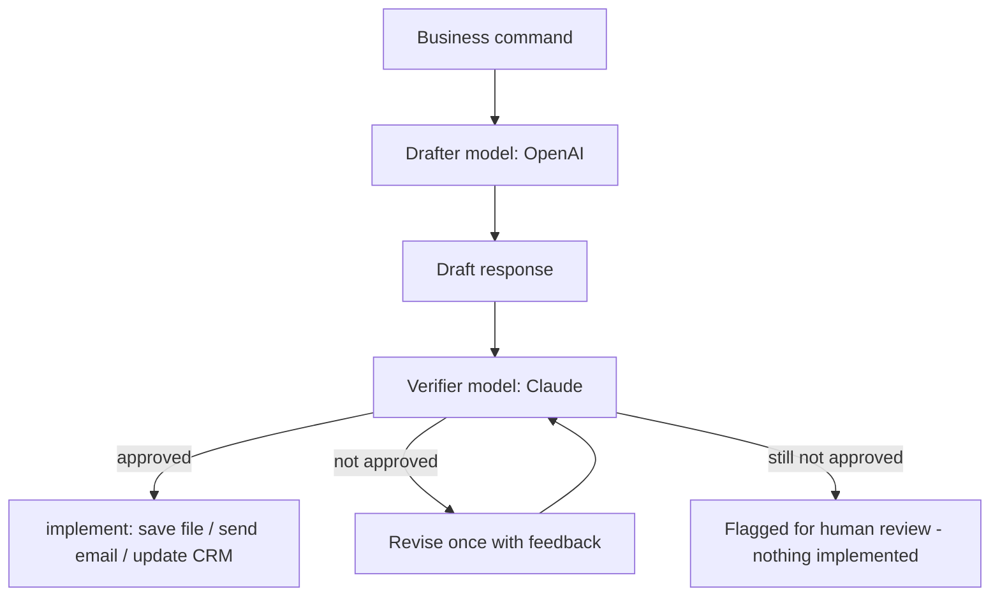
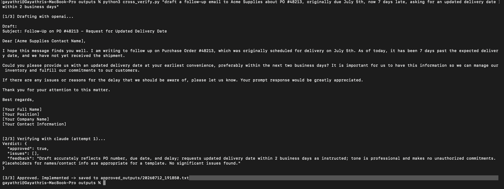
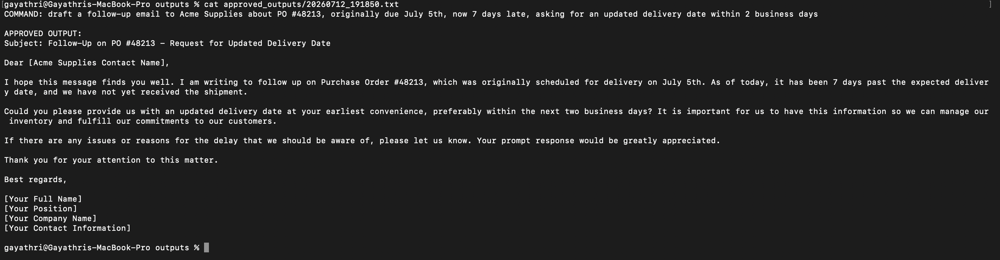

# Cross-Model Verification Assistant

A Python-based prototype exploring cross-model AI verification for enterprise workflows.

The solution uses OpenAI to generate an initial response and Claude to independently review it before approval. It explores structured verification, rejection and revision workflows, and human-review fallback.

I developed this prototype to explore how multiple AI models can be orchestrated to improve output reliability and introduce safeguards before AI-generated responses are used in business processes.

## Why this matters for enterprise AI

Any single model can hallucinate, misread intent, or make an unauthorized
commitment (a refund, a deadline, a discount) on a company's behalf.
Enterprises that let AI take real actions — updating a CRM, sending customer
emails, triggering a workflow — need a check before execution. Two common
patterns:

1. **Cross-model verification** (this project): a second, independent model
   reviews the first model's output before it's acted on. Different training
   data and failure modes make it more likely to catch mistakes than asking
   the same model to check itself.
2. **Human-in-the-loop approval**: same idea, but a person approves instead
   of (or in addition to) a second model. The `implement()` function is the
   natural place to add a Slack/email approval step.

This is the architecture behind "LLM-as-judge" and is a core building block
of trustworthy AI agent design.

## Architecture



Text version, if the diagram above doesn't render:

```
command
   |
   v
[DRAFTER model] --> produces a draft response/action
   |
   v
[VERIFIER model] --> checks accuracy, tone, missing info, risk
   |
   +-- approved --> implement() --> saved to approved_outputs/ (swap for
   |                                 real action: send email, Slack, CRM)
   |
   +-- not approved --> feedback sent back to drafter for one revision
                          --> still fails --> flagged for human review,
                              nothing is implemented
```

By default: OpenAI drafts, Claude verifies. Swap `drafter`/`verifier` in
`run()` to flip roles, or run it both ways and compare.

## Features

- Drafts a business response with one model, verifies with an independent
  second model — not the same model checking its own work.
- Verifier returns structured JSON (`approved`, `issues`, `feedback`), not
  just a vague opinion, so the result is machine-actionable.
- One automatic revision cycle: failed drafts go back to the drafter with
  the verifier's specific feedback before giving up.
- Fails safe: if verification still fails after a revision, nothing is
  implemented and it's flagged for a human — it never guesses.
- Implementation step is isolated in one function (`implement()`), so
  swapping "save to file" for "send email" / "post to Slack" / "update CRM"
  is a single, contained change.

## Screenshots

_Add your own screenshots to a `screenshots/` folder in this project, then
reference them here, e.g.:_

```


```

## Setup

```bash
pip install -r requirements.txt --break-system-packages
cp .env.example .env
# open .env and paste in your real Anthropic + OpenAI API keys
```

Get keys from:
- Anthropic: https://console.anthropic.com/settings/keys
- OpenAI: https://platform.openai.com/api-keys

## Run it

```bash
python3 cross_verify.py "draft a follow-up email to Acme Supplies about PO #48213, originally due July 5th, now 7 days late, asking for an updated delivery date within 2 business days"
```

Or run without an argument and it will prompt you for a command
interactively. Approved output lands in `approved_outputs/<timestamp>.txt`.

Be specific in your command — see Lessons Learned below for why vague
commands get rejected by design, not by accident.

## Extending toward a real handoff (e.g. for a manager who wants this ready-made)

Once this logic is proven, the natural next step for a non-technical user is
to move it into **n8n** so there's no code to maintain:

- **Trigger node**: a chat/webhook node where the command is typed in.
- **HTTP Request / AI node** for the drafter model.
- **HTTP Request / AI node** for the verifier model, with the same
  approve/reject JSON contract used here.
- **IF node**: approved → route to an action node (Send Email, Slack,
  CRM update); not approved → route to a "needs human review" notification.

## Future Improvements

- Wire `implement()` to a real action: Gmail API to actually send the
  approved email, or a Slack webhook, or a CRM update (Salesforce/HubSpot).
- Pull real record data (order number, customer name, dates) from a CRM/ERP
  before drafting, instead of relying on the command to spell everything out.
- Add a human-approval step (e.g. Slack message with Approve/Reject buttons)
  as a third checkpoint alongside the model verifier.
- Log every run (command, draft, verdict, final decision) to a file or
  database for an audit trail — important for any enterprise deployment.
- Support swapping in more than two models (e.g. a three-way vote) for
  higher-stakes actions.

## Lessons Learned

- **Claude's response can include a "thinking" block before the text
  block.** The first version of `ask_claude()` assumed `content[0]` was
  always the text, which crashed with `AttributeError: 'ThinkingBlock'
  object has no attribute 'text'`. Fixed by scanning `response.content`
  for the block with `type == "text"` instead of hardcoding the index —
  a good reminder to never assume API response shape, always inspect it.
- **Verification failures are often a sign the input was underspecified,
  not that the system is broken.** Early test runs used a vague command
  ("draft a follow-up email to the vendor...") with no real order number,
  vendor name, or date. The drafter invented placeholders, and the
  verifier correctly rejected them rather than approving a fabricated
  email. Once the command included real specifics, it passed verification
  on the first attempt. This mirrors a real enterprise lesson: an AI
  guardrail rejecting incomplete input is the system working, not failing.
- **Two independent models catch different classes of mistakes than one
  model reviewing itself.** The verifier flagged tone, missing deadlines,
  and unauthorized-sounding commitments that a single-model pass would be
  unlikely to catch on its own.

## Notes / limits of this prototype

- Verifier output is parsed as JSON; if a model doesn't follow the format,
  the run is marked "not approved" and flagged rather than guessed at.
- `implement()` only writes a file right now — intentionally, so nothing
  gets sent/executed until a real action is wired up deliberately.
- No conversation memory between commands — each run is independent.
